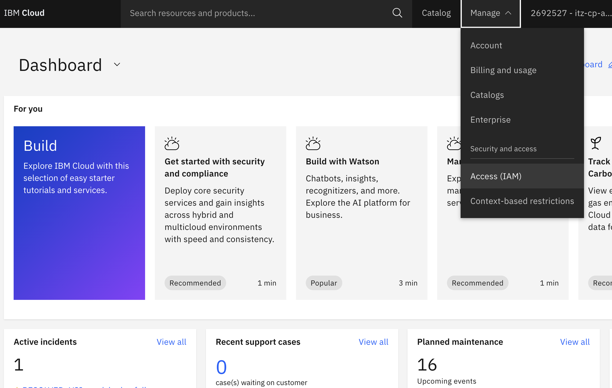
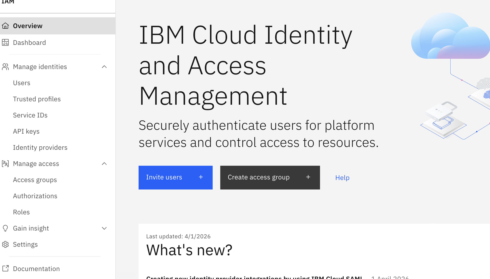
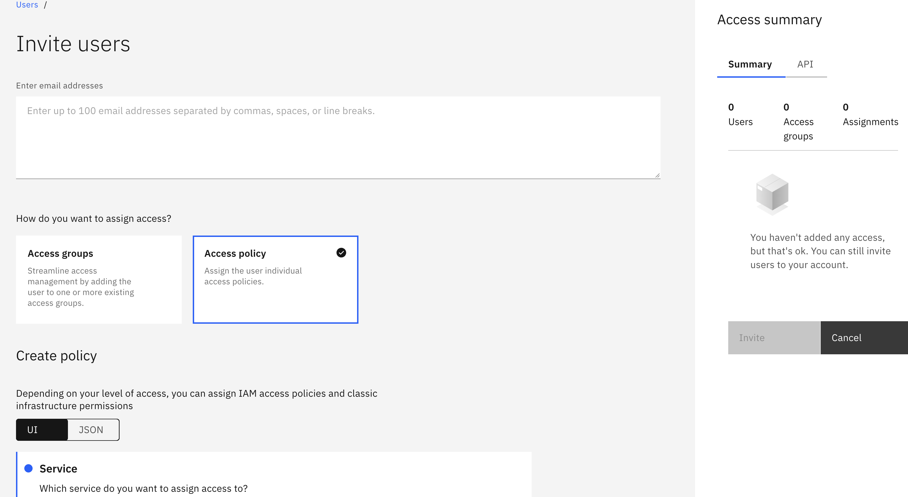
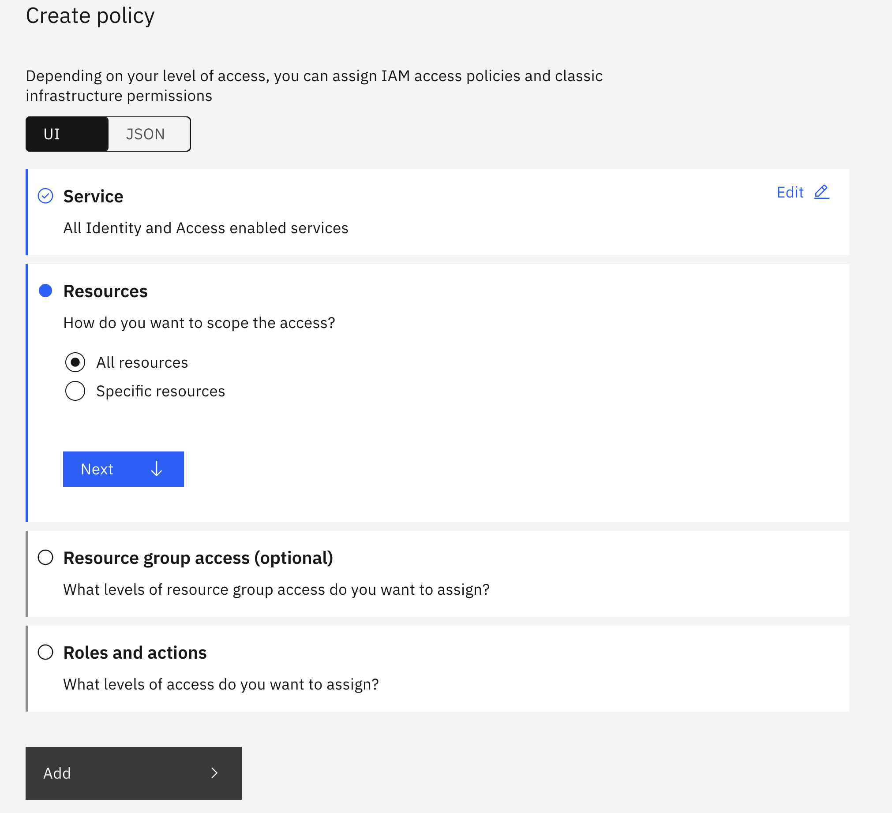
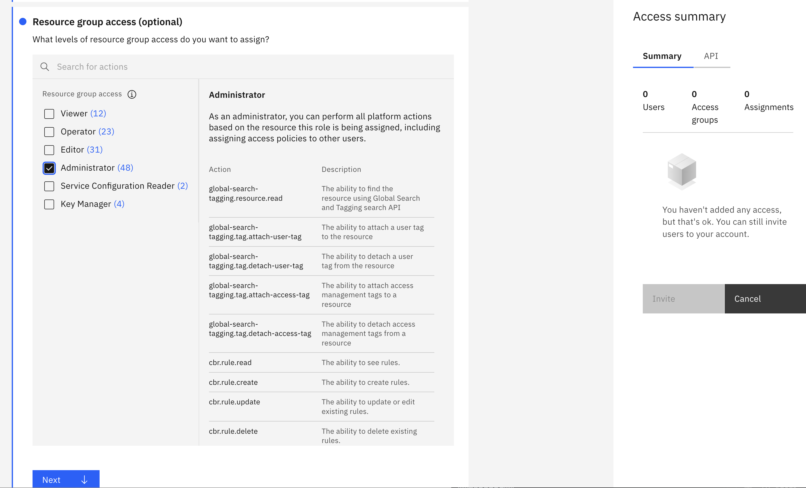
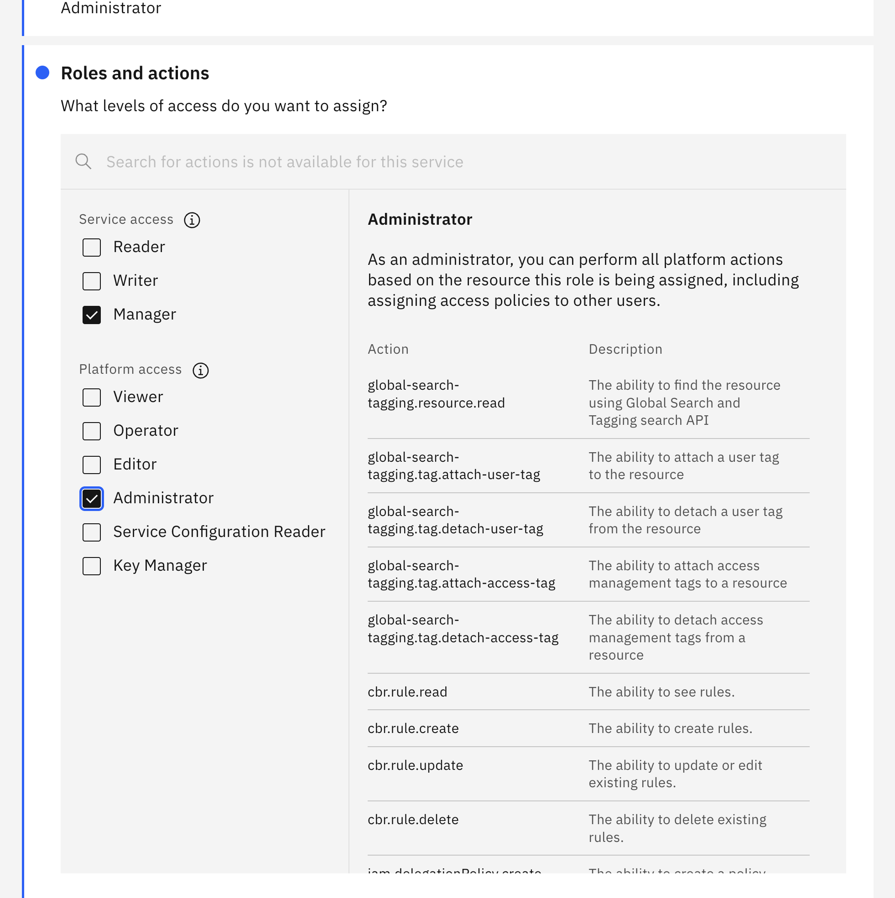
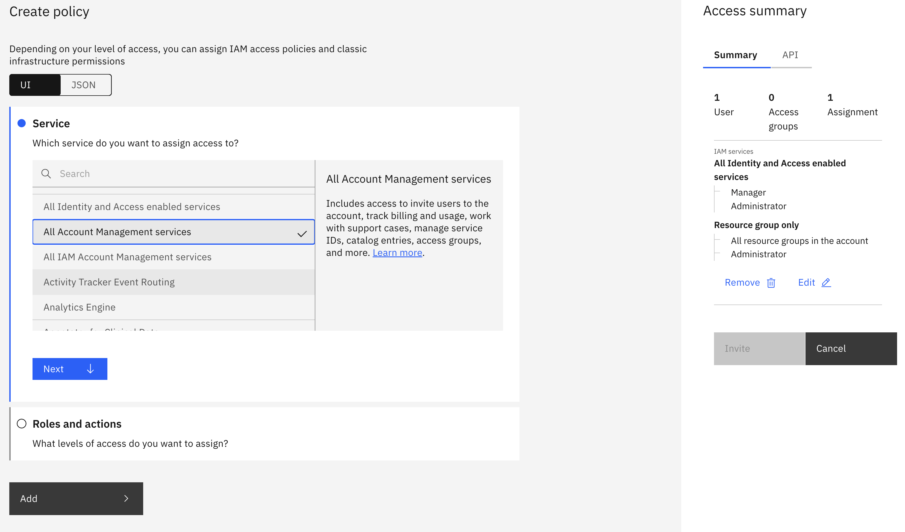
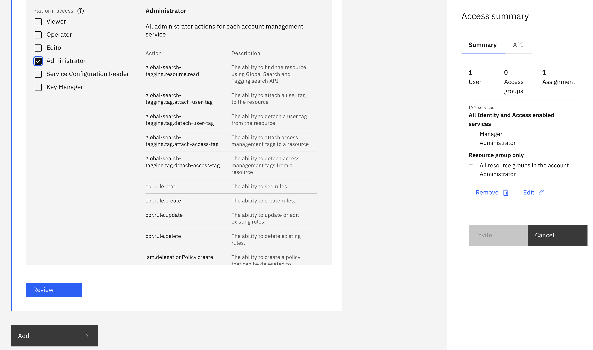
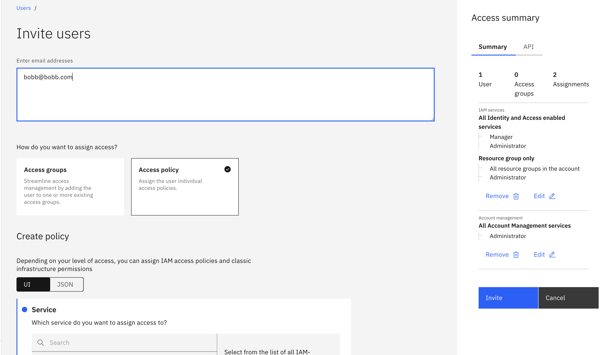

# Invite a User as Account Admin in IBM Cloud

Invite a user and give them account-wide administrator access in a single flow, without using an access group.

> **Last verified:** 2026-09-29. The IBM Cloud console changes often. If a label doesn't match, check the [IBM Cloud IAM docs](https://cloud.ibm.com/docs/account?topic=account-iamoverview).

## Prerequisites

- You are the **account owner**, or you have **Administrator** on IAM services.
- You have the invitee's email address.

## What "account-wide admin" means here

IBM Cloud has no single admin switch. Full admin is two policies, both assigned during the invite:

| Policy | Platform role | Service role |
|---|---|---|
| All Identity and Access enabled services | Administrator | Manager |
| All Account Management services | Administrator | n/a |

---

## Step 1: Open Manage > Access (IAM)

Log in at [cloud.ibm.com](https://cloud.ibm.com). Click **Manage** in the top nav, then **Access (IAM)**.

## Step 2: Start the invite

On the IAM overview page, click **Invite users**.

## Step 3: Choose "Access policy"

Under **How do you want to assign access?**, choose **Access policy** (not Access groups) so you can assign policies directly to this user.

## Step 4: First policy — service

In **Create policy**, leave **Service** set to **All Identity and Access enabled services**, and under **Resources** choose **All resources**. Click **Next**.

## Step 5: First policy — resource group access

Under **Resource group access**, check **Administrator**, then click **Next**.

## Step 6: First policy — roles and actions

Under **Roles and actions**, set **Service access** to **Manager** and **Platform access** to **Administrator**. Click **Add** to save the policy.

## Step 7: Second policy — service

Add another policy. This time set **Service** to **All Account Management services**. The access summary panel on the right now shows the first policy already added.

## Step 8: Second policy — roles and actions

Under **Platform access**, check **Administrator**, then click **Review**.

## Step 9: Enter the email and send the invite

Enter the invitee's email address. Confirm the **Access summary** panel shows both assignments — Manager/Administrator on IAM services, and Administrator on account management — then click **Invite**.

## Step 10: Verify

After the user accepts the invite and logs in, confirm they can open:

- **Manage > Access (IAM) > Users**
- **Manage > Billing and usage**

---

## Not covered by these policies

Granted separately if needed:

- **Cloud Foundry** org and space roles
- **Classic infrastructure** permissions
- **Account owner** rights (for example, closing the account). No policy grants these.

## Trade-off

Policies assigned directly to a user are harder to audit and revoke than access group policies. Removing this person later means finding and deleting each policy by hand, or removing them from the account.

## Troubleshooting

| Symptom | Likely cause |
|---|---|
| Invite sent but user sees no IAM menu | Invite not accepted yet, or user needs to re-login |
| User can't invite others | Missing Account Management policy |
| Can't manage Cloud Foundry or classic resources | Separate roles needed (see above) |
